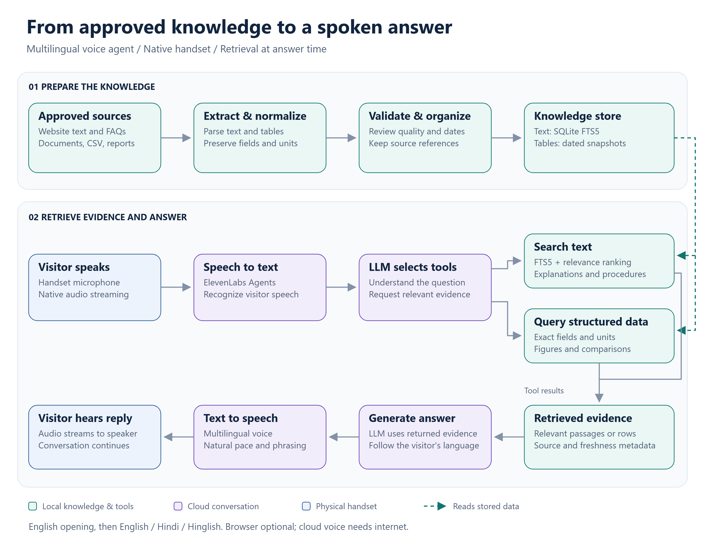
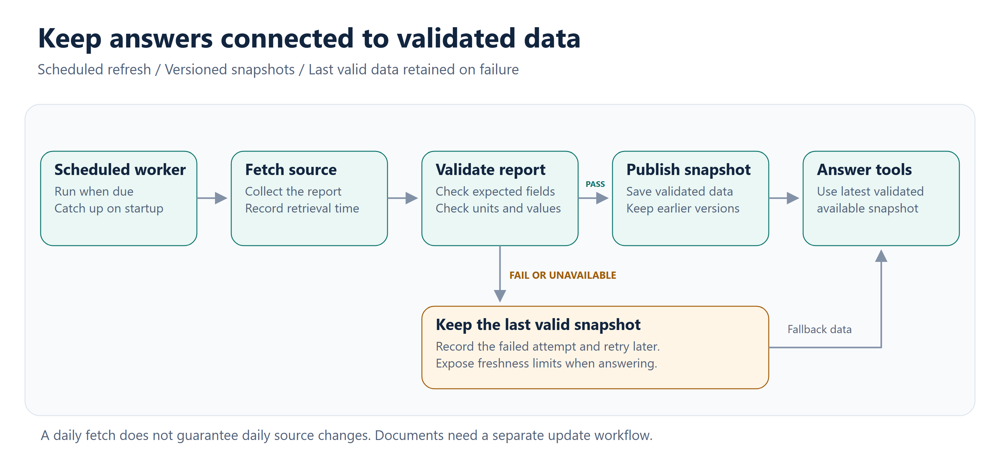

# Multilingual RAG Voice Agent

A voice assistant that answers questions using an approved knowledge base, delivered through a physical telephone interface. Visitors lift the handset, enter a configured access code, and speak naturally with the assistant.

The application combines **Retrieval-Augmented Generation (RAG)**, structured data tools, ElevenLabs Agents, and native Windows hardware handling. It starts with an English greeting and follows the visitor's language: English, Hindi, or Hinglish.

This README is a public technical overview. Client identities, source websites, business documents, datasets, credentials, and deployment identifiers are excluded. The implementation and deployment package remain private; this document alone is not a runnable application.

**The interaction works like a familiar telephone conversation.**

1. Lift the handset to activate dialing and hear a pickup tone.
2. Enter the configured code using the physical keypad.
3. Hear keypad tones and a short connecting ring. An incorrect code triggers a spoken retry prompt.
4. Ask a question and receive a spoken answer supported by retrieved information.
5. Continue in English, Hindi, or Hinglish, including switching languages during the conversation.
6. Replace the handset to end the session and release the microphone and speaker.

The native application receives hardware events independently of browser focus. The browser can be closed or another application can be in the foreground. An awake, signed-in Windows session and a running native process are still required.

**The RAG pipeline has two parts: preparing knowledge and answering questions.**



[View full-size image](github-voice-agent-assets/rag-voice-pipeline.png) · [Editable SVG](github-voice-agent-assets/rag-voice-pipeline.svg)

During preparation, source adapters extract website text, FAQs, document paragraphs, and tables. The deployed workflow uses DOCX content, previously extracted document text, CSV archives, and collected reports. Each source requires a suitable parser and validation rules; support for a new website or file layout requires integration work.

Text is stored as searchable passages with source references and location metadata. Numerical records retain their field names, units, reporting periods, and missing values. Material awaiting review, including unverified OCR or uncertain table extraction, is excluded from factual answer tools.

At conversation time, the model selects a tool based on the question. Explanations use text retrieval; numerical questions use structured records. This keeps changing figures out of a fixed FAQ answer and allows comparisons to be calculated from available snapshots.

The current text retriever uses **SQLite FTS5**, BM25 ranking, query expansion, and additional relevance scoring. It uses keyword retrieval rather than embedding vectors. FTS5 and its ranking functions are documented in the [official SQLite reference](https://www.sqlite.org/fts5.html).

For Hindi and Hinglish questions, the agent is instructed to formulate an English retrieval query while preserving names and dates, then answer in the visitor's language. Retrieved passages are evidence, not instructions that can override the assistant's behavior.

**RAG supplies evidence at answer time.** The base language model is not trained or fine-tuned on the project documents. Updating the knowledge store makes new information available without changing model weights. A question bank supports review and evaluation; it is not a substitute for retrieval or a guarantee that every possible question is covered.

**Changing data follows a separate refresh pipeline.**



[View full-size image](github-voice-agent-assets/data-refresh-pipeline.png) · [Editable SVG](github-voice-agent-assets/data-refresh-pipeline.svg)

The refresh worker runs at a configured daily time while the application is running and checks for missed refreshes on startup. It validates collected reports before publishing them, retains earlier snapshots for comparisons, and keeps the last valid data if a fetch fails.

A daily fetch does not prove that the source itself changes daily. The agent provides the **latest successfully retrieved and validated information**, which may differ from the source's current state. Retrieval time and source reporting time are separate facts. The existing scheduled collector covers selected changing statistics; documents, directories, and historical archives need their own update and ingestion workflow.

Routine speech avoids reading technical retrieval metadata aloud. Dates remain available for verification, historical questions, and freshness clarification. When a source is old, conflicting, or unavailable, the assistant should explain the limitation instead of presenting a guess as current information.

**Responsibilities are split between the local application and the voice provider.**

| Component | Responsibility |
| --- | --- |
| Python native application | Handset state, keypad input, session lifecycle, audio streaming, and local tool execution |
| Windows Raw Input | Identify handset HID events independently of the focused window |
| SQLite and FTS5 | Store evidence, search text, and retain validated snapshots |
| Source adapters | Collect, parse, normalize, and validate approved data |
| ElevenLabs Agents | Speech recognition, conversational model orchestration, tool requests, and speech generation |
| WebSocket connection | Exchange streaming audio and conversation events |
| sounddevice and soundfile | Handle local microphone, speaker, and cached audio prompts |
| FastAPI and optional browser interface | Local monitoring and development controls |

The native application implements the provider's client tools and returns their results to the conversation. A browser is not required to execute these tools. See the [ElevenLabs client tools documentation](https://elevenlabs.io/docs/eleven-agents/customization/tools/client-tools) for the provider-side configuration model.

The conversation still requires an LLM for answer generation. In this design it is selected through the ElevenLabs agent configuration. Whether a separate model-provider key is needed depends on the selected model and account configuration; the local retrieval database itself does not generate conversational answers.

**To set up an authorized copy on Windows, use the private application package.** The commands below run from its application directory, where `native_run.py`, `requirements-site.txt`, and `backend/` are located. They do not download the private implementation from this README.

1. **Prepare the computer.** Use the package's tested Python 3.11, 64-bit environment, a microphone and speaker, and the compatible USB handset/keypad. The native input implementation targets Windows. Verify the packaged browser collector separately on the destination Windows version. Internet access and an active ElevenLabs account with available usage are required for conversations.

2. **Install the runtime.** The deployment package provides a setup launcher and bundled dependency wheels. For a developer installation with internet access, create an isolated environment from the application directory:

   ```powershell
   py -3.11 -m venv .venv
   .\.venv\Scripts\python.exe -m pip install -r requirements-site.txt
   ```

   A source collector that uses Playwright also needs its matching browser. Use the bundled browser configuration when supplied; otherwise install it with:

   ```powershell
   .\.venv\Scripts\python.exe -m playwright install chromium
   ```

3. **Configure the account privately.** Copy `.env.example` to `.env` if no local configuration exists. Keep its deployment settings and fill in the credentials for an agent and voice you are authorized to use:

   ```dotenv
   ELEVENLABS_API_KEY=your_private_api_key
   ELEVENLABS_AGENT_ID=your_agent_id
   ELEVENLABS_VOICE_ID=your_approved_voice_id
   ```

   Configure the provider agent's model, factual-answer instructions, language detection, voice, and client tool schemas. Tool names and parameters must match the local handlers; adding a voice ID alone does not configure RAG. The private package includes provisioning and update scripts for this purpose.

4. **Prepare the knowledge store.** Use the validated database supplied with the package, or configure the source paths and run its ingestion workflow. To adapt the application to another use case, first update the source adapters, table schemas, tool definitions, and assistant instructions. Check that explanations retrieve the correct passages and numerical queries preserve units and reporting periods.

5. **Configure the handset.** Select the intended Windows microphone and speaker and allow microphone access for desktop apps. Inspect available devices, then leave the handset on its cradle while binding it:

   ```powershell
   .\.venv\Scripts\python.exe native_run.py --devices
   .\.venv\Scripts\python.exe -m backend.native_input --bind
   ```

   The current hardware sends repeated zero-key signals while on the cradle and stops sending them when lifted. The native controller distinguishes these sensor signals from dialing. Different hardware needs its event mapping adapted; device bindings must be checked again on a new computer.

6. **Validate and start.** Run the packaged checks, then start the native process:

   ```powershell
   .\.venv\Scripts\python.exe -m backend.site_check --ready --browser
   .\.venv\Scripts\python.exe native_run.py
   ```

   The deployment launchers also support hidden background operation, status checks, and graceful shutdown. To inspect or stop a running instance from another terminal:

   ```powershell
   .\.venv\Scripts\python.exe native_run.py --status
   .\.venv\Scripts\python.exe native_run.py --stop
   ```

7. **Test the physical experience.** Verify pickup, the first keypad digit, incorrect codes, connection audio, language switching, interruption, silence handling, and hang-up. Repeat with the browser closed and another window focused. Confirm that hang-up stops microphone capture and playback. Compare sample answers with their source evidence and test the refresh workflow at the deployment location.

**Natural conversation needs both configuration and listening tests.** The agent opens in English, then follows the visitor's language. Hindi speech text uses Devanagari to reduce English-style pronunciation of Hindi words; mixed responses retain appropriate English terms. Voice selection, multilingual synthesis, sentence length, and speaking speed all affect the result. ElevenLabs documents [language and voice configuration](https://elevenlabs.io/docs/eleven-agents/customization/voice/customization/language), but final pronunciation and pacing need human evaluation on the actual speaker.

Streaming reduces waiting compared with playing a fully generated recording, but response time still depends on the network, retrieval, model, and speech provider. A connecting sound does not guarantee that the remote session will be ready within the sound's duration.

**The same architecture can support several use cases after adapting the knowledge and tools.**

| Setting | Example use |
| --- | --- |
| Customer support desk | Explain service procedures, required documents, and common troubleshooting steps |
| Exhibition or visitor kiosk | Let visitors explore approved information through a telephone conversation |
| Retail showroom | Answer product questions using verified specifications and published policies |
| Campus or reception desk | Explain admissions procedures, office locations, and visitor instructions |
| Museum or information centre | Provide multilingual explanations drawn from curated exhibit material |
| Internal employee help desk | Retrieve approved onboarding, IT, or administrative guidance |
| Operations information station | Read validated metrics and compare available historical snapshots |

These are adaptation examples, not integrations already delivered. Booking, payments, ticket creation, authenticated customer records, and calls through a public telephone network require additional tools and access controls. The current handset is a local computer-connected interface, not a telephone carrier connection.

**Deployment boundaries remain important.**

- The knowledge database is local, but visitor audio and retrieved evidence used for answers are sent to the cloud conversation provider. This is not an entirely offline or on-device system.
- Keep `.env`, private source material, databases, recordings, runtime logs, signed session URLs, and configured deployment archives out of a public repository. This public README contains placeholders only.
- Use a voice you have permission to deploy and configure provider retention to match the installation's requirements.
- Retrieval reduces unsupported answers but does not guarantee correctness. Test representative questions, conflicting sources, missing data, multilingual phrasing, and network failures before visitor use.
- Enable startup behavior only after device and audio checks pass. Background operation depends on the local Windows session remaining available.

This project demonstrates a voice interface backed by traceable retrieval, structured data access, and independent hardware control. Its public documentation describes the engineering approach without distributing the private deployment or its business knowledge.
